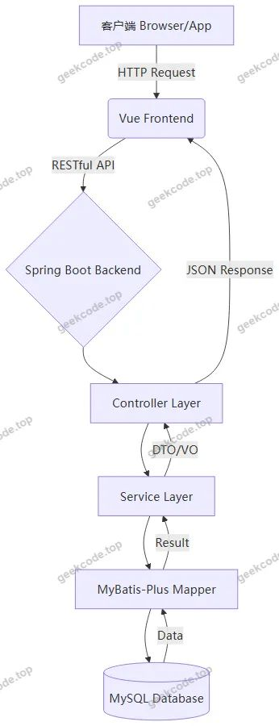
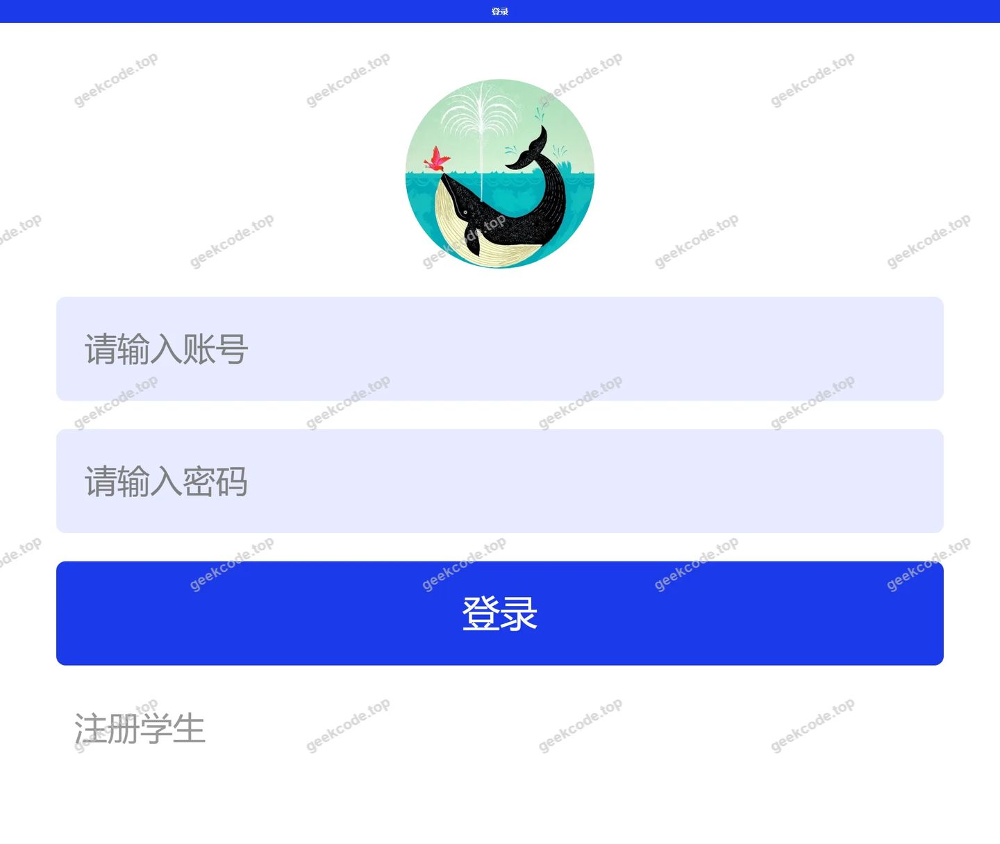
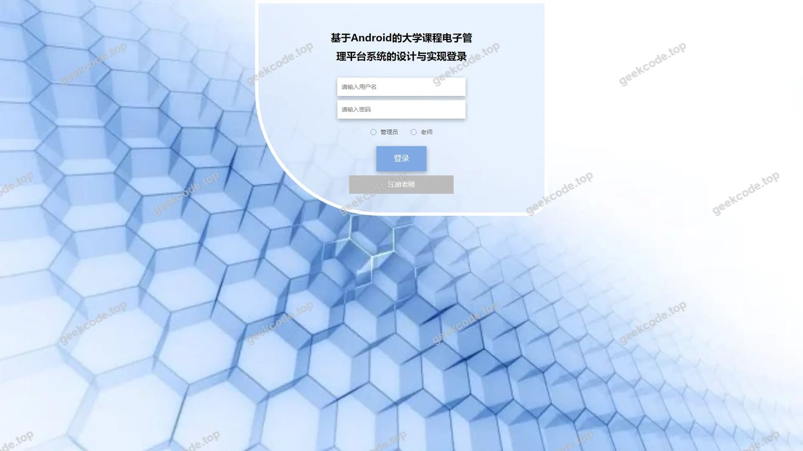
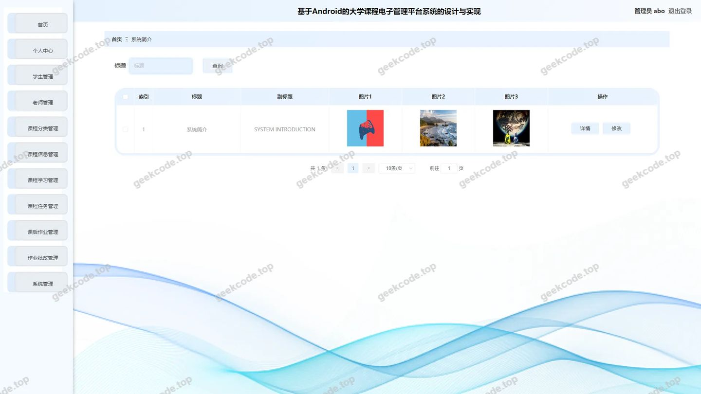
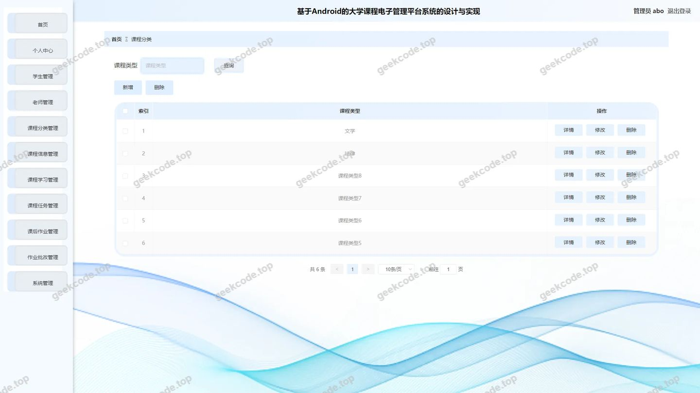
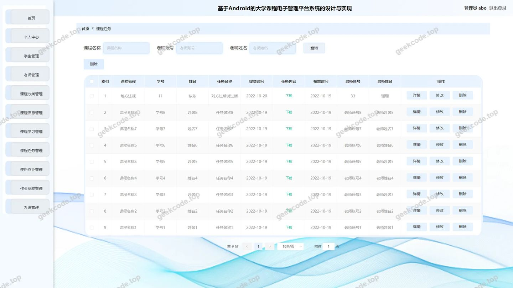
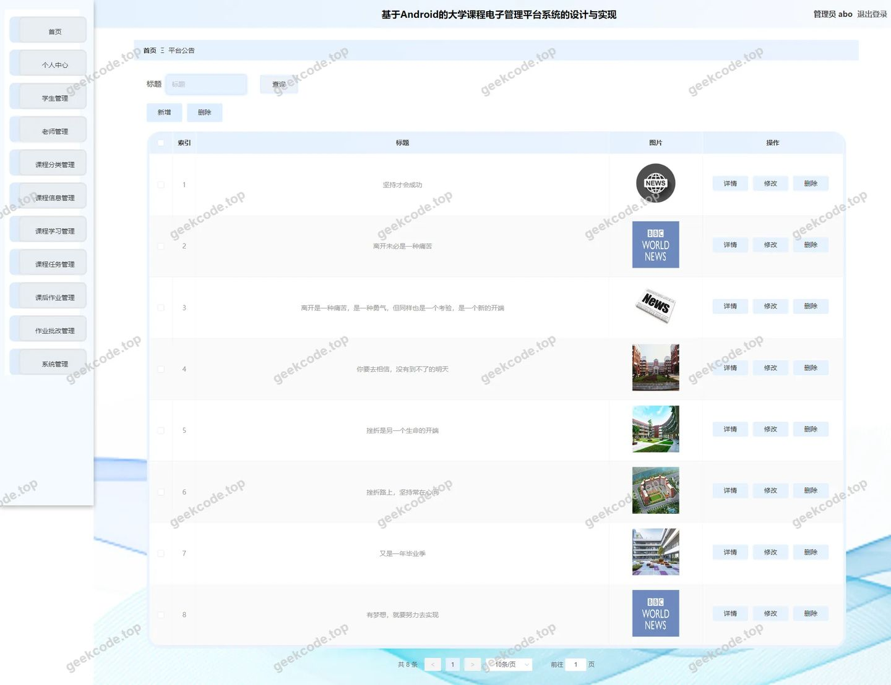
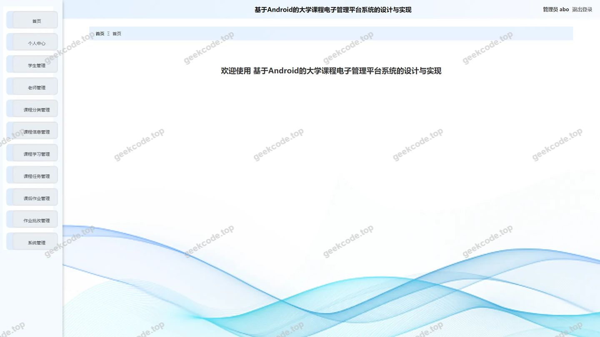
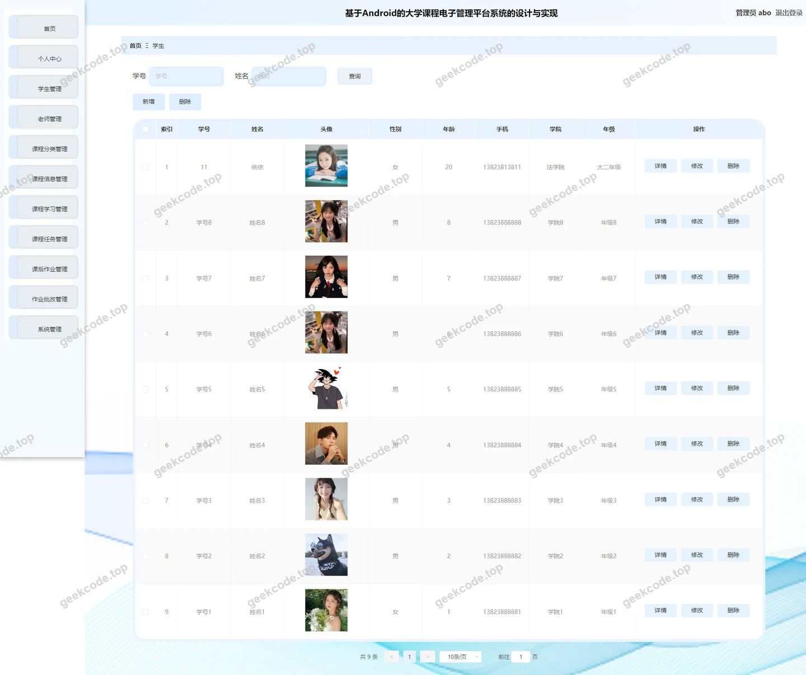
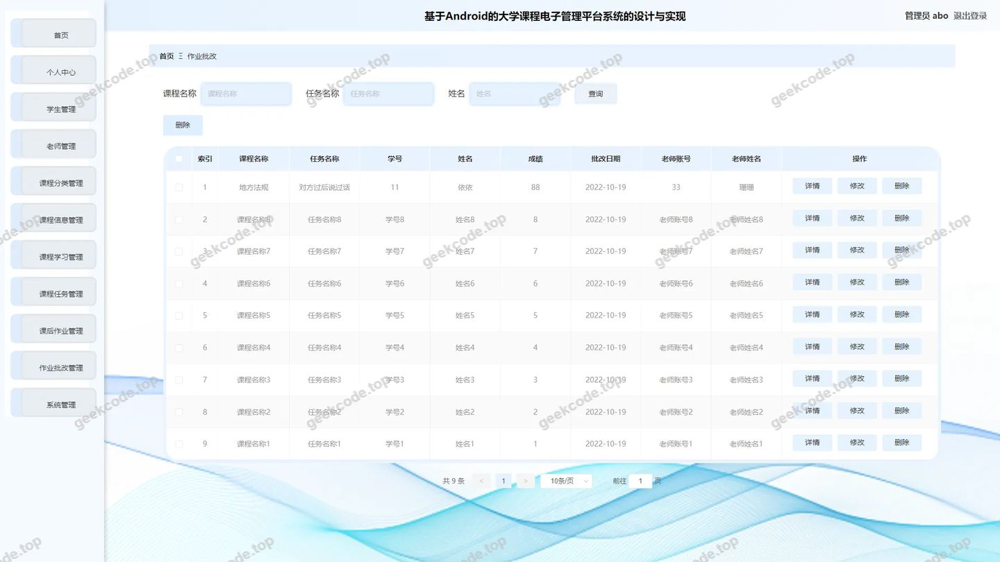

# 基于Android的大学课程电子管理平台系统的设计与实现

> 🎓 **计算机毕业设计 · 基于Android的大学课程电子管理平台系统的设计与实现**
>
> 本仓库只放**项目介绍 + 运行截图**（截图是站点带水印的原图，存在仓库 `images/` 里）。
>
> 👉 **完整可运行源码 / 数据库脚本 / 部署文档：[点我获取](https://geekcode.top/archives/%E5%9F%BA%E4%BA%8EAndroid%E7%9A%84%E5%A4%A7%E5%AD%A6%E8%AF%BE%E7%A8%8B%E7%94%B5%E5%AD%90%E7%AE%A1%E7%90%86%E5%B9%B3%E5%8F%B0%E7%B3%BB%E7%BB%9F%E7%9A%84%E8%AE%BE%E8%AE%A1%E4%B8%8E%E5%AE%9E%E7%8E%B0?utm_source=github)**
>
> 💬 咨询微信：**ir9372**　|　🌐 更多项目：[极客代码 geekcode.top](https://geekcode.top/?utm_source=github)
>
> 📌 项目详情页：<https://geekcode.top/archives/%E5%9F%BA%E4%BA%8EAndroid%E7%9A%84%E5%A4%A7%E5%AD%A6%E8%AF%BE%E7%A8%8B%E7%94%B5%E5%AD%90%E7%AE%A1%E7%90%86%E5%B9%B3%E5%8F%B0%E7%B3%BB%E7%BB%9F%E7%9A%84%E8%AE%BE%E8%AE%A1%E4%B8%8E%E5%AE%9E%E7%8E%B0?utm_source=github>

<table><td width="230" align="center"> <b>扫码加微信 ir9372</b></td><td valign="middle">📦 源码 = 项目介绍 + 全部运行截图 + 数据库 + 部署文档 👉 点上方任意截图，直接跳到 <b>极客代码 geekcode.top</b> 详情页</td></table>

---

<h1>基于Android的大学课程电子管理平台系统的设计与实现</h1>
<h2>项目概述</h2>

本项目旨在构建一个基于Android架构理念与Web技术融合的大学课程电子管理平台，核心目标是实现高校教学资源的数字化管理与师生互动的高效化。系统采用前后端分离模式，后端基于Spring Boot框架结合MyBatis-Plus持久层技术，前端采用Vue集成方案。主要功能涵盖课程信息管理、作业发布与批改、学生及教师档案维护、平台公告发布等模块。适用人群包括高校管理员、授课教师及在校学生。通过该平台，管理者可集中维护课程分类与基础信息，教师能高效处理课后作业反馈，学生则可便捷获取学习资源与任务通知，从而提升校园教学管理的信息化水平与协作效率。

<h2>技术架构</h2>

本系统采用经典的分层架构设计，确保系统的可维护性与扩展性。

<strong>后端架构：</strong>
核心框架选用 Spring Boot，利用其自动配置特性快速搭建应用骨架。持久层采用 MyBatis-Plus，简化了单表 CRUD 操作并支持复杂查询定制。数据库连接池使用 Druid，提供强大的监控功能和高性能的数据访问能力。业务逻辑层通过 Controller（如 <code>KechengxinxiController</code>, <code>LaoshiController</code> 等）接收请求，Service 层处理具体业务，Mapper 层执行数据交互。依赖库包含 <code>spring-webmvc</code> 用于 RESTful API 开发，<code>spring-tx</code> 保证事务一致性。

<strong>前端架构：</strong>
采用 Vue-integrated 模式，即前端视图层与后端服务紧密集成或独立部署后通过 API 通信。后台管理界面通过路由 <code>/admin</code> 相关路径进行模块化展示，支持动态菜单加载。

<strong>数据库设计要点：</strong>
基于实体类映射关系，主要涉及以下核心数据表结构：

<ol>
<li><strong>用户体系</strong>：<code>Users</code>（通用账户）、<code>Xuesheng</code>（学生详情）、<code>Laoshi</code>（教师详情）。</li>
<li><strong>课程资源</strong>：<code>Kechengfenlei</code>（课程分类）、<code>Kechengxinxi</code>（课程基本信息）、<code>Kechengrenwu</code>（课程任务/作业定义）。</li>
<li><strong>教学过程</strong>：<code>Kehouzuoye</code>（课后作业提交记录）、<code>Zuoyepigai</code>（作业批改状态与评语）、<code>Kechengxuexi</code>（课程学习进度或记录）。</li>
<li><strong>系统内容</strong>：<code>News</code>（平台公告）、<code>Systemintro</code>（系统简介）、<code>Config</code>（系统参数配置）。</li>
</ol>

<h2>功能模块</h2>

根据后台路由配置及截图所示，系统主要分为以下功能模块：

<h3>1. 后台管理端 (Admin)</h3>

后台是系统的核心操作入口，所有管理功能均在此完成。

<ul>
<li><strong>系统登录与安全</strong> (<code>/admin/login</code>)</li>
<li>提供管理员身份认证入口，保障系统数据安全。</li>
<li><strong>平台公告管理</strong> (<code>/news</code>)</li>
<li>对应 <code>NewsController</code>。支持发布、编辑、删除和查看平台通知，用于向师生传达重要教务信息。</li>
<li><strong>课程信息管理</strong> (<code>/kechengxinxi</code>)</li>
<li>对应 <code>KechengxinxiController</code>。负责课程基本属性（名称、描述、所属类别等）的增删改查。</li>
<li><strong>课程分类管理</strong> (<code>/kechengfenlei</code>)</li>
<li>对应 <code>KechengfenleiController</code>。维护课程的层级分类体系，便于课程检索与管理。</li>
<li><strong>课程任务管理</strong> (<code>/kechengrenwu</code>)</li>
<li>对应 <code>KechengrenwuController</code>。定义具体的学习任务或作业要求，关联特定课程。</li>
<li><strong>课后作业管理</strong> (<code>/kehouszuoye</code>)</li>
<li>对应 <code>KehouzuoyeController</code>。查看学生提交的作业列表，支持作业的导入导出或状态追踪。</li>
<li><strong>作业批改模块</strong> (<code>/zuoyepigai</code>)</li>
<li>对应截图“后台-作业批改”。教师或管理员在此界面查看学生提交的作业内容，并进行评分和文字反馈。</li>
<li><strong>课程学习记录</strong> (<code>/kechengxuexi</code>)</li>
<li>对应 <code>KechengxuexiController</code>。跟踪学生的课程参与情况和学习进度数据。</li>
<li><strong>用户档案管理</strong></li>
<li><strong>学生管理</strong> (<code>/xuesheng</code>)：对应 <code>Xuesheng</code> 实体，维护学生基本信息、班级归属等。</li>
<li><strong>教师管理</strong> (<code>/laoshi</code>)：对应 <code>LaoshiController</code>，维护教师个人信息、教授课程关联等。</li>
<li><strong>系统配置与维护</strong></li>
<li><strong>系统简介</strong> (<code>/systemintro</code>)：对应 <code>SystemintroController</code>，编辑平台介绍文案，用于前台展示或帮助文档。</li>
<li><strong>参数配置</strong> (<code>/config</code>)：对应 <code>ConfigController</code>，管理系统全局变量、开关设置等底层配置。</li>
<li><strong>文件服务</strong>：由 <code>FileController</code> 支撑，处理头像、作业附件等文件的上传与下载。</li>
</ul>
<h3>2. 前台用户端 (Front)</h3>

虽然源码中未明确列出独立的前台路由细节，但根据“是否有前台: 是”及截图“前台首页框架”，推断前台具备基础的信息展示能力。

<ul>
<li><strong>首页展示</strong>：呈现平台公告、推荐课程或系统简介。</li>
<li><strong>信息浏览</strong>：用户可查阅公开的课程信息和通知。</li>
<li><em>(注：具体交互功能如在线做题、详细个人中心等未在提供的路由列表中明确体现，故仅描述可见的框架存在)</em></li>
</ul>
<h2>用户角色与权限</h2>

基于控制器命名（如 <code>LaoshiController</code>, <code>Xuesheng</code> 表）及后台功能划分，系统隐含以下角色模型：

<h3>1. 系统管理员 (Administrator)</h3>

拥有最高权限，通过后台 <code>/admin</code> 路径进入。

<ul>
<li><strong>权限范围</strong>：</li>
<li><strong>全量数据管理</strong>：可对所有模块（新闻、课程、分类、任务、作业、用户、配置）进行增删改查。</li>
<li><strong>用户管理</strong>：创建和维护学生与教师账号信息。</li>
<li><strong>系统维护</strong>：修改系统简介、调整全局配置参数。</li>
<li><strong>审核与监管</strong>：查看所有作业批改记录和学生学习状态。</li>
</ul>
<h3>2. 教师 (Teacher/Laoshi)</h3>

作为教学活动的执行者，可能在后台拥有受限视图或在前台拥有特定操作权（依据常规毕设逻辑推导，若仅基于代码上下文，教师数据在后台被管理，暗示教师可能通过普通用户登录或直接由管理员代管，但若系统支持多角色登录，则如下）：

<ul>
<li><strong>假设权限</strong>（基于 <code>LaoshiController</code> 的存在及作业批改需求）：</li>
<li><strong>课程维护</strong>：管理自己负责的课程信息及任务发布。</li>
<li><strong>作业处理</strong>：访问 <code>/zuoyepigai</code> 模块，查看所授课程的学生作业并提交批改意见。</li>
<li><strong>资料上传</strong>：通过 <code>FileController</code> 上传课件或作业模板。</li>
</ul>
<h3>3. 学生 (Student/Xuesheng)</h3>

作为服务对象，主要通过前台或受限后台接口交互。

<ul>
<li><strong>假设权限</strong>：</li>
<li><strong>信息获取</strong>：浏览 <code>/news</code> 公告，查看 <code>/kechengxinxi</code> 课程详情。</li>
<li><strong>任务执行</strong>：查看 <code>/kechengrenwu</code> 中的作业要求，提交 <code>/kehouszuoye</code>。</li>
<li><strong>结果查询</strong>：查看自己的作业批改结果及 <code>/kechengxuexi</code> 学习进度。</li>
</ul>

<em>(说明：由于提供的上下文主要为后台路由和Controller，且未提供具体的RBAC权限配置文件，上述教师与学生的具体隔离策略需结合实际登录鉴权逻辑确定，此处基于模块功能进行合理职能划分。)</em>

<h2>项目特色与创新点</h2>
<ol>
<li>
<strong>一体化教学闭环管理</strong>：
   系统将“课程定义 -&gt; 任务发布 -&gt; 作业提交 -&gt; 批改反馈 -&gt; 学习记录”串联为完整的数据流。通过 <code>Kechengrenwu</code> 与 <code>Zuoyepigai</code> 的联动，实现了从布置到评估的全流程数字化，解决了传统教学中纸质作业流转慢、统计难的问题。

</li>
<li>
<strong>细粒度的数据建模</strong>：
   区别于简单的课程列表，项目将“课程分类”、“课程信息”、“课程任务”、“课后作业”拆分为独立的实体和控制器。这种解耦设计使得系统能够灵活应对不同学科、不同形式的教学活动（如视频课、实验课、纯作业课），提高了平台的适应性。

</li>
<li>
<strong>高效的持久层实现</strong>：
   引入 MyBatis-Plus 替代原生 MyBatis，大幅减少了 SQL 样板代码。配合 Druid 连接池的高性能监控，提升了系统在并发访问下的稳定性，特别是在处理大量学生作业提交时的数据库读写压力。

</li>
<li>
<strong>模块化后台架构</strong>：
   后台路由清晰划分为内容管理（News, Systemintro）、业务管理（Kecheng*, Zuoye*, Kehou*）和用户管理（Xuesheng, Laoshi, Users）。这种结构符合现代 Web 应用的低耦合高内聚原则，便于后续功能的迭代与插件式扩展。

</li>
</ol>
<h2>部署环境</h2>

为确保系统正常运行，需准备以下软硬件环境：

<strong>硬件要求：</strong>

<ul>
<li>CPU: 双核及以上</li>
<li>内存: 4GB RAM 及以上（建议 8GB 以支持 Druid 监控及 Java 虚拟机开销）</li>
<li>硬盘: 至少 20GB 可用空间</li>
</ul>

<strong>软件环境：</strong>

<ul>
<li><strong>操作系统</strong>: Windows 10/11, Linux (CentOS 7+, Ubuntu 20.04+), macOS</li>
<li><strong>Java 运行时</strong>: JDK 1.8 或更高版本（推荐 JDK 1.8 以兼容大多数 Spring Boot 旧版本稳定包，若项目使用较新 Spring Boot 则需 JDK 11+）</li>
<li><strong>数据库</strong>: MySQL 5.7 或 MySQL 8.0</li>
<li>字符集建议设置为 <code>utf8mb4</code> 以支持特殊符号存储。</li>
<li><strong>构建工具</strong>: Maven 3.6+ （用于编译打包后端代码）</li>
<li><strong>Node.js</strong>: v14.x 或 v16.x （用于前端 Vue 项目的依赖安装与构建，若前端已预编译则可选）</li>
<li><strong>Web 服务器</strong>: Nginx (用于反向代理前端静态资源及后端 API) 或 Tomcat (嵌入式于 Spring Boot JAR 中)</li>
</ul>

<strong>启动步骤简述：</strong>

<ol>
<li>初始化 MySQL 数据库，导入对应的 <code>.sql</code> 脚本文件。</li>
<li>修改后端配置文件（<code>application.yml</code> 或 <code>application.properties</code>），更新数据库连接 URL、用户名和密码。</li>
<li>使用 Maven 命令 <code>mvn clean package</code> 打包后端项目，生成 <code>.jar</code> 文件。</li>
<li>运行 <code>java -jar target/xxx.jar</code> 启动后端服务。</li>
<li>进入前端目录，执行 <code>npm install</code> 安装依赖，随后执行 <code>npm run serve</code> (开发模式) 或 <code>npm run build</code> (生产模式)。</li>
<li>通过浏览器访问指定端口即可使用系统。</li>
</ol>
<h2>五、技术特性</h2>
<ul>
<li>前后端集成部署，前端资源打包至后端 static 目录</li>
<li>使用 MyBatis-Plus 简化数据访问层开发</li>
</ul>
<h2>六、功能模块截图</h2>
<h3>前台用户端</h3>
<h4>前台首页框架</h4>

<h3>后台管理端</h3>
<h4>后台-登录页</h4>

<h4>后台-系统简介</h4>

<h4>后台-课程分类</h4>

<h4>后台-课程任务</h4>

<h4>后台-平台公告</h4>

<h4>后台首页</h4>

<h4>后台-学生</h4>

<h4>后台-作业批改</h4>

---

## 获取完整源码

| 项目 | 说明 |
| --- | --- |
| 项目名 | 基于Android的大学课程电子管理平台系统的设计与实现 |
| 运行截图 | 本文 10 张（站点带水印原图，仓库 `images/` 目录） |
| 完整源码 | [https://geekcode.top/archives/%E5%9F%BA%E4%BA%8EAndroid%E7%9A%84%E5%A4%A7%E5%AD%A6%E8%AF%BE%E7%A8%8B%E7%94%B5%E5%AD%90%E7%AE%A1%E7%90%86%E5%B9%B3%E5%8F%B0%E7%B3%BB%E7%BB%9F%E7%9A%84%E8%AE%BE%E8%AE%A1%E4%B8%8E%E5%AE%9E%E7%8E%B0?utm_source=github](https://geekcode.top/archives/%E5%9F%BA%E4%BA%8EAndroid%E7%9A%84%E5%A4%A7%E5%AD%A6%E8%AF%BE%E7%A8%8B%E7%94%B5%E5%AD%90%E7%AE%A1%E7%90%86%E5%B9%B3%E5%8F%B0%E7%B3%BB%E7%BB%9F%E7%9A%84%E8%AE%BE%E8%AE%A1%E4%B8%8E%E5%AE%9E%E7%8E%B0?utm_source=github) |
| 咨询微信 | **ir9372**（备注：jingpin-yuanma） |
| 更多项目 | [极客代码 geekcode.top](https://geekcode.top/?utm_source=github) |

> 需要源码、部署、改配置、跑不起来等问题，加微信 ir9372 沟通，说明项目名即可。
